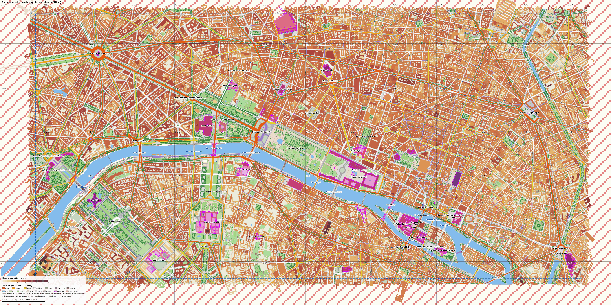
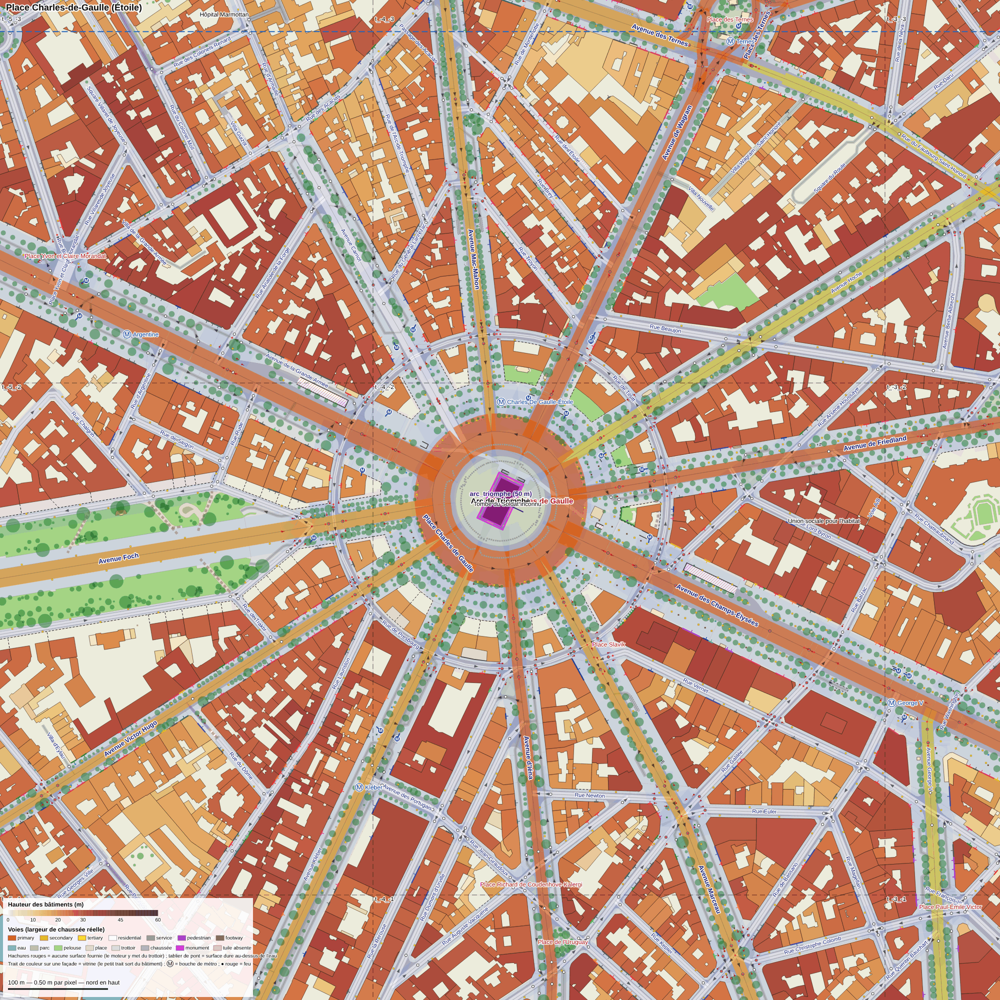
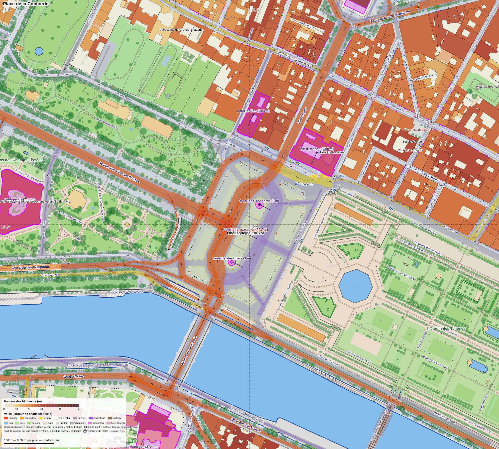
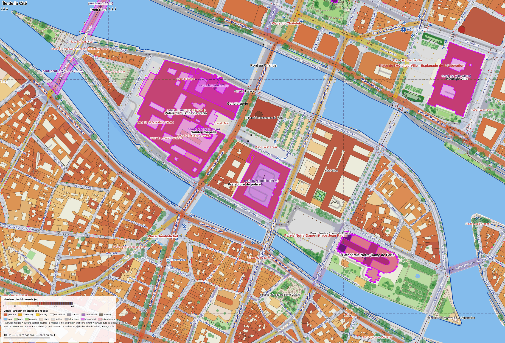
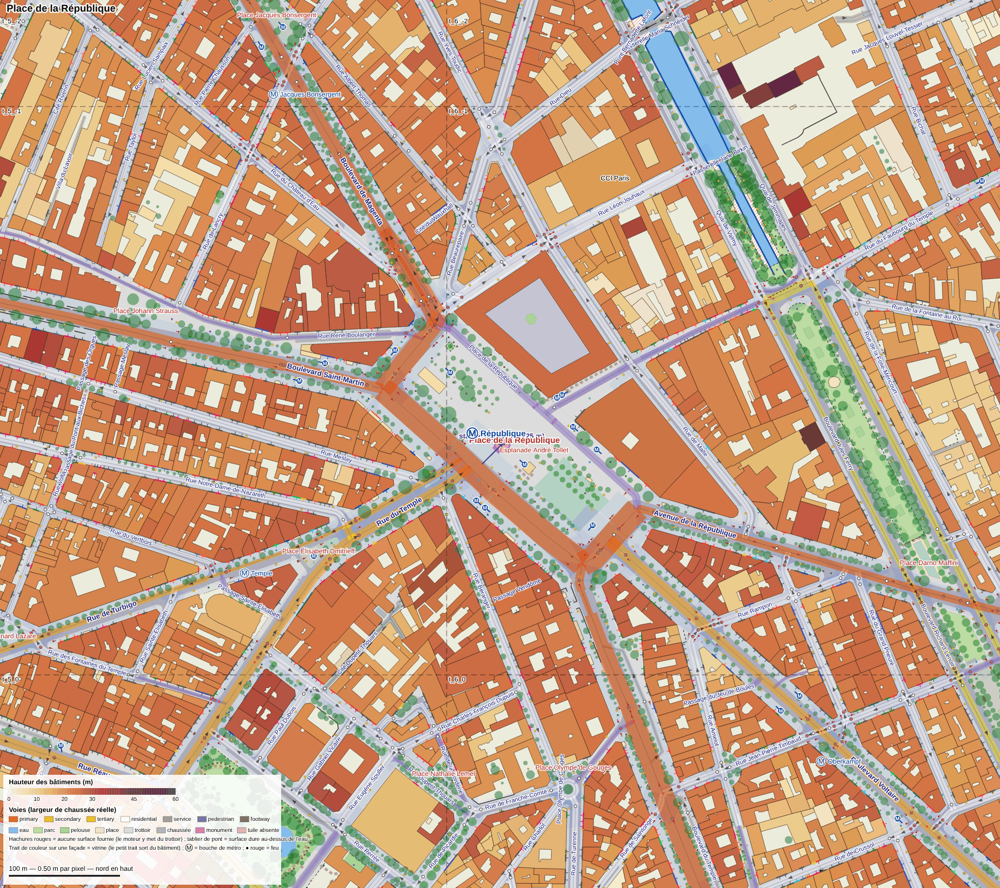
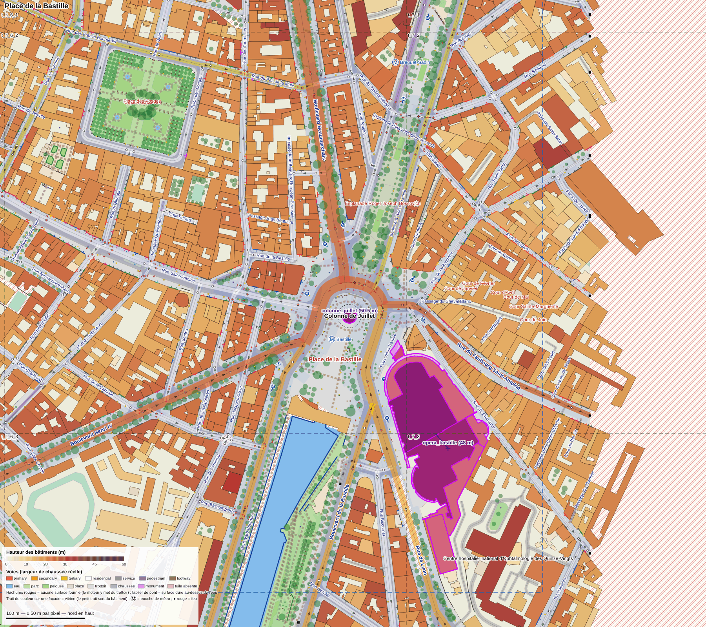
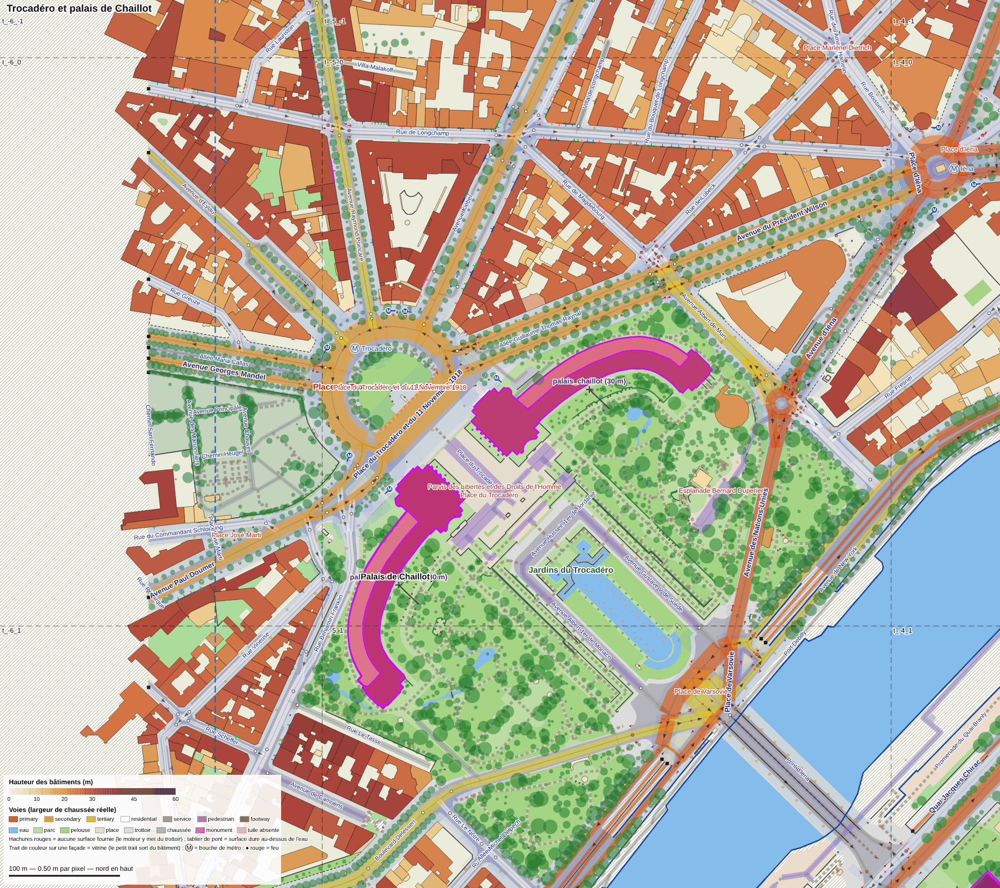
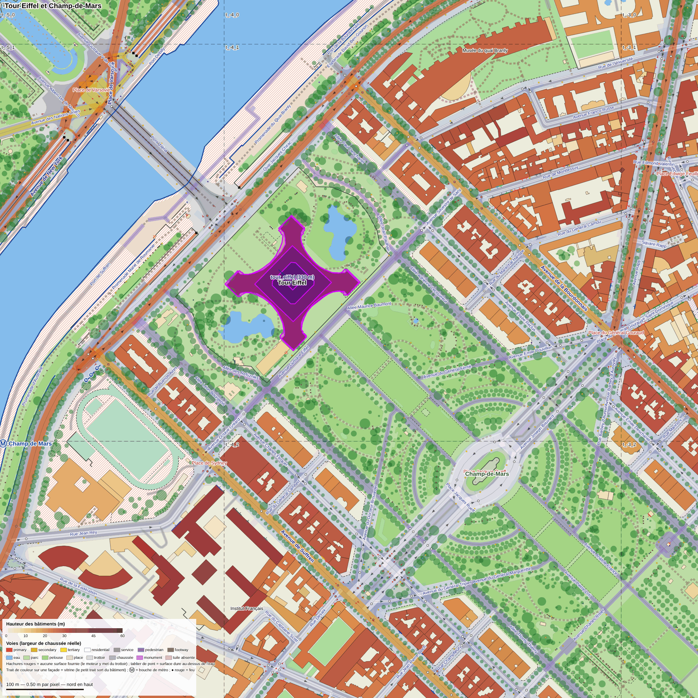
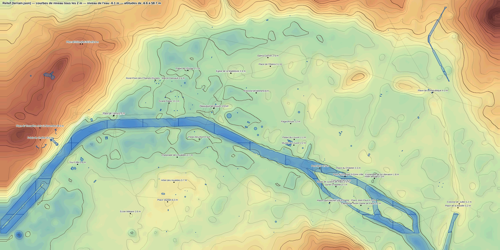
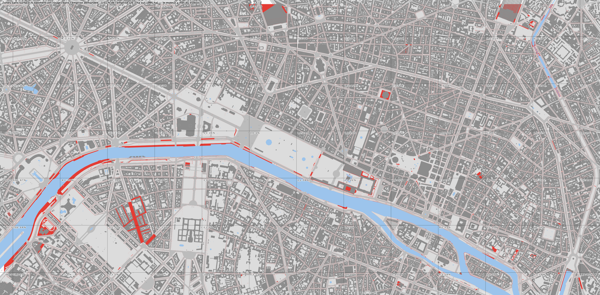

# Carte de Paris — vérification indépendante

> Vérification de la carte publiée dans `public/data/paris/`, faite après sa construction (`docs/map-build.md`), par
> un regard qui n'a pas écrit la construction. État au 16 novembre 2026.
> Outils : `tools/map/render-check.mjs` (images) et `tools/map/verify-map.mjs` (mesures) ; aucun des deux ne partage de
> code avec `build*.mjs`. Tests : `tests/unit/mapdata.verify.test.ts`.

## 1. En bref

- **On reconnaît Paris.** La Seine et ses deux îles, les douze avenues de l'Étoile, les Champs-Élysées, la Concorde, les
  Tuileries et le Louvre, les Invalides, le Champ-de-Mars et la Tour Eiffel, le Trocadéro, l'Opéra, la Madeleine, les
  Halles, le Marais, la République, la Bastille et le bassin de l'Arsenal sont à leur place, à la bonne échelle.
- **Dix défauts ont été trouvés et corrigés** dans les scripts de construction (§ 5) ; la carte a été reconstruite, redessinée
  et regardée de nouveau. Le plus visible : 4,1 km de murs de quai tracés en surface au-dessus du canal Saint-Martin
  couvert (boulevard Richard-Lenoir, place de la Bastille). Les plus nombreux : 1 980 objets de mobilier, 176 arbres et
  52 supports de feux posés dans l'emprise d'un bâtiment, 64 bouches de métro dans un immeuble ou une gare.
- **70 contrôles chiffrés : 68 réussis, 2 « à surveiller », 0 en échec** sur la carte finale. Sur la dernière carte
  enregistrée dans git avant correction, le même script en met 9 en échec.
- **Aucune enseigne commerciale** dans les 3 183 chaînes publiées, après une relecture complète qui a fait retirer
  39 noms de lieux, 5 noms de bâtiments et 4 noms de voies (§ 6). L'attribution des cinq sources est dans le manifeste.
- **Ce qui reste imparfait** est listé au § 7. Le chargement de la carte dans le jeu en marche (navigateur, téléphone)
  n'a toujours pas été essayé : seuls le décodeur, les contrôles et un rendu 2D ont tourné dessus.

| | Avant vérification | Après |
|---|---|---|
| Fichiers, taille | 104 ; 9 517 800 octets | 104 ; 9 510 231 octets (9,07 Mo ; 3,52 Mo en gzip) |
| Bâtiments | 30 564 | 30 564 (inchangés, 5 noms retirés) |
| Surfaces (morceaux) | 30 252 | 30 250 (9 trous invalides retirés) |
| Barrières (morceaux) | 3 965, dont 41,0 km de murs de quai | 3 946, dont 36,2 km de murs de quai |
| Arbres | 38 109 | 37 961 |
| Mobilier | 24 183 | 24 054 |
| Supports de feux | 6 701 | 6 696 |
| Bouches de métro | 442 | 442 (63 déplacées) |
| Commerces | 26 476 | 26 476 (inchangés) |
| Graphe | 17 242 nœuds, 20 060 arêtes, 297 nœuds de limite | 17 264 nœuds, 20 082 arêtes, 357 nœuds de limite |
| Lieux nommés | 3 023 | 2 984 |
| Monuments | 43 | 43 (inchangés) |

## 2. Refaire la vérification

```
node tools/map/build.mjs            # reconstruit public/data/paris/ (10 s environ)
node tools/map/verify-map.mjs       # 70 contrôles ; code de sortie 1 si l'un échoue ; rapport raw/build/verify.json
node tools/map/render-check.mjs     # 10 images dans docs/img/ (25 s environ)
npx vitest run tests/unit/mapdata   # 3 fichiers, 94 tests
```

`CRS_MAP_OUT=<dossier>` fait porter les trois scripts sur une autre carte. `render-check.mjs --box nom:x0,z0,x1,z1[:px/m]
--out <dossier>` dessine une fenêtre libre (mètres monde).

Indépendance des deux outils :

- `render-check.mjs` ne lit que les fichiers publiés et les décode avec son **propre décodeur**, écrit d'après
  `docs/map-format.md` (deltas, colonnes creuses, tables de chaînes). Il n'importe pas `mapdata.ts`.
- `verify-map.mjs` lit avec le décodeur du jeu, puis mesure avec sa propre géométrie.
- Les deux décodeurs sont recoupés : la somme de toutes les coordonnées (en décimètres) vaut **3 302 208 631** pour les
  contours de bâtiments et **416 984 114** pour les arêtes, des deux côtés.
- Les positions de référence des monuments viennent de **Wikidata** (propriété P625, licence CC0), relevées le
  16 novembre 2026 par une seule requête à `query.wikidata.org` et recopiées dans `verify-map.mjs`. Elles ne servent qu'à
  contrôler ; elles n'entrent dans aucun fichier du jeu.

## 3. Les images, et ce qu'on y voit

Toutes sont au nord en haut. Bâtiments teintés selon la hauteur (du beige, bas, au brun-violet, haut) ; voies du graphe
à leur largeur de chaussée, colorées par classe ; surfaces dans l'ordre du fichier ; **tablier de pont = surface dure
au-dessus de l'eau** (règle du moteur, `src/world/view/raster.ts`) ; monuments en magenta ; **hachures rouges = aucune
surface fournie** (le moteur y met du trottoir) ; carrés noirs = nœuds de limite ; ronds bleus « M » = bouches de métro ;
sur les gros plans, un trait de couleur sur une façade est une vitrine et son petit trait perpendiculaire sa normale.

### Vue d'ensemble — `img/map-overview.png` (4000 × 2000 px, 1,79 m par pixel, les 98 tuiles)



On reconnaît Paris au premier coup d'œil. La Seine traverse l'image d'est en ouest avec sa boucle vers le sud-ouest,
l'île de la Cité et l'île Saint-Louis, l'île aux Cygnes en bas à gauche. L'Étoile et ses avenues rayonnantes sont en haut
à gauche ; l'axe Étoile – Champs-Élysées – Concorde – Tuileries – Louvre est rectiligne. Le Champ-de-Mars, les Invalides
et leur esplanade, le jardin des Tuileries, le Palais-Royal, la place des Vosges, l'hôpital Saint-Louis et le canal
Saint-Martin se lisent sans légende. Les 98 tuiles sont toutes remplies ; aucune limite de tuile ne se voit dans le
dessin (pas de bâtiment coupé, pas de bande vide). Les données s'arrêtent 60 m au-delà de l'emprise demandée (tirets
bleus) ; les bâtiments à cheval sur cette marge sont entiers, ce qui donne le bord en dents de scie. Hachures dans
l'emprise : les faisceaux de voies de la gare Saint-Lazare et de la gare de l'Est (le format a une surface « rail », la
source n'en fournit pas) et les berges basses de la Seine.

### Étoile — `img/map-etoile.png`



Les **douze avenues** sont là et portent leur nom : Grande-Armée, Carnot, Mac-Mahon, Wagram, Hoche, Friedland,
Champs-Élysées, Marceau, Iéna, Kléber, Victor-Hugo, Foch. L'anneau de la place est à sens unique, large de 36 m. L'Arc
de Triomphe (45 × 22 m) est au centre, son grand côté perpendiculaire à l'axe des Champs-Élysées. Les rues de Tilsitt et
de Presbourg dessinent le second cercle. L'avenue Foch a ses pelouses et ses contre-allées. Les cours d'îlot sont
couvertes (pas de hachures). Deux rectangles hachurés, sur la Grande-Armée et sur les Champs-Élysées : les trémies du
souterrain de l'Étoile, que le plan de voirie ne dessine pas.

### Concorde — `img/map-concorde.png`



L'obélisque est à 19 m au sud-ouest de l'origine du monde (l'origine du BRIEF est le centre de la place, pas le pied de
l'obélisque), entre les deux fontaines alignées sur l'axe de la rue Royale. L'hôtel de la Marine et son pendant
encadrent la rue Royale, la Madeleine ferme la perspective au nord. Le pont de la Concorde a son tablier de 37 m entre
ses garde-corps. La place a sa configuration d'après 2024 dans OpenStreetMap : la circulation passe à l'ouest, la moitié
est est piétonne (en violet). C'est fidèle à la source, mais ce n'est pas la place « à huit voies » que l'on a en tête.
Les carrés noirs autour de la place sont les bouches des souterrains (voie Georges-Pompidou, passage inférieur du
cours la Reine).

### Île de la Cité — `img/map-cite.png`



Pont Neuf (en deux parties, de part et d'autre de la pointe du Vert-Galant), place Dauphine, Palais de Justice avec la
Sainte-Chapelle et la Conciergerie, préfecture de police, Hôtel-Dieu, parvis et cathédrale Notre-Dame, puis l'Hôtel de
Ville sur la rive droite. Tous les ponts ont leur tablier : pont au Change, pont Notre-Dame, pont d'Arcole, pont
Saint-Michel, Petit-Pont, pont au Double, pont Saint-Louis (piéton), pont de l'Archevêché. Les murs de quai (en bleu
foncé) suivent les deux bras.

### République — `img/map-republique.png`



La place rectangulaire d'après 2013 : chaussée au sud-ouest, esplanade piétonne au nord-est, monument au centre, cinq
bouches de métro. Boulevards Saint-Martin, de Magenta, du Temple et Voltaire, avenue de la République, rue du
Faubourg-du-Temple. En haut à droite, le canal Saint-Martin à ciel ouvert, avec ses écluses et ses passerelles, puis les
jardins du boulevard Jules-Ferry au-dessus du canal couvert : **avant correction, trois traits de mur de quai
traversaient ces jardins**.

### Bastille — `img/map-bastille.png`



Colonne de Juillet, opéra Bastille, place des Vosges, bassin de l'Arsenal et ses quais, boulevards Beaumarchais, Henri-IV,
Richard-Lenoir, Bourdon et de la Bastille, rue du Faubourg-Saint-Antoine, rue de Lyon. La place a sa configuration de
2021 (presqu'île piétonne vers l'Arsenal). **Avant correction, les murs de quai du canal couvert coupaient la place en
deux**, de la colonne au bassin. Le bord est de l'image est le bord des données (carrés noirs : nœuds de limite).

### Trocadéro — `img/map-trocadero.png`



Les deux ailes courbes du palais de Chaillot ouvertes vers la Seine, le parvis entre elles, les jardins et la fontaine
de Varsovie, la place du Trocadéro et ses six avenues, le cimetière de Passy, le pont d'Iéna. Le bord ouest de l'emprise
passe à 170 m de la place : les avenues qui partent vers l'ouest s'arrêtent sur un nœud de limite.

### Tour Eiffel — `img/map-tour-eiffel.png`



L'empreinte en croix de la tour, ses quatre piliers aux points cardinaux, les deux bassins, le Champ-de-Mars et ses
allées, l'avenue de la Bourdonnais et l'avenue de Suffren, le pont d'Iéna, le musée du quai Branly. Les **berges basses**
(port de la Bourdonnais, port de Suffren) sont hachurées : aucune surface ne les décrit, alors que le format a une
nature « quay ». Le stade Émile-Anthoine, en bas à gauche, est dans le même cas.

### Relief — `img/map-relief.png`



Le fond de vallée de la Seine au centre (0 à 5 m), la colline de Chaillot et l'Étoile au nord-ouest (25 à 28 m), les
premières pentes de Belleville au nord-est et de la montagne Sainte-Geneviève au sud. Le lit du fleuve est comblé depuis
les berges (choix de la construction) : le plan d'eau, à −6,1 m, passe sous le sol voisin et le moteur doit ouvrir le
sol le long des polygones d'eau.

### Zones sans surface — `img/map-holes.png`



En rouge, ce qui n'est couvert ni par une surface ni par un bâtiment : **1,01 % de l'emprise demandée (20,1 ha sur
1 995 ha)**. Ce sont, dans l'ordre : les berges basses de la Seine, un quartier de rues du Gros-Caillou (autour de
l'avenue Bosquet et de la rue Cler) où le plan de voirie n'a ni chaussée ni trottoir, les faisceaux ferroviaires, le
pourtour de la Bourse, le stade Émile-Anthoine. Tuiles les plus touchées : −6_2 (12,3 % de sa part d'emprise), −5_1
(8,7 %), −3_1 (7,9 %), −4_0 (7,2 %). Le moteur peint ces zones en trottoir, et les chaussées du graphe là où la carte
ne dit rien : ce n'est pas un trou dans le sol, c'est un sol sans détail.

## 4. Contrôles chiffrés (carte finale)

Sortie complète : `node tools/map/verify-map.mjs`. Les deux lignes « à surveiller » sont reprises au § 7.

| Contrôle | Résultat |
|---|---|
| Fichiers, taille | 104 fichiers, 9 510 231 octets (limites : 110 et 30 Mo) ; 98 tuiles de 13 193 à 161 428 octets, médiane 83 873 ; aucune tuile manquante, périmée ou vide |
| Projection | les constantes du BRIEF s'écartent de l'ellipsoïde WGS84 de 0,006 % en latitude et de 0,086 % en longitude : 5,5 m d'est en ouest sur toute l'emprise |
| 20 repères (Wikidata) | 20/20 : la position de référence tombe dans l'emprise publiée du monument (16) ou à moins de 40 m d'elle ; écart à l'ancrage : médiane 8,5 m ; décalage moyen 1 m vers l'est et 0,9 m vers le nord, donc pas d'erreur systématique |
| Hauteurs de monuments | 12/12 à 15 % près (Tour Eiffel 330 m, Arc 50 m, Notre-Dame 96 m, colonne de Juillet 50,5 m…) |
| Hauteurs des bâtiments | médiane 21,8 m ; 5 % sous 4,1 m ; 95 % sous 28,6 m ; 29 % entre 21 et 24 m ; 6 immeubles de plus de 60 m hors monuments (les tours du Front de Seine, 95 à 98 m, à l'angle sud-ouest) |
| Bâtiments sans hauteur dans la source | 1 383 emprises sur 31 194 (4,43 %) ; 5 923 (19 %) sans nombre de niveaux |
| Polygones | 65 090 anneaux : 0 mal orienté, 0 qui se recoupe, 0 d'aire nulle, 0 trou hors de son contour, 0 surface hors de sa tuile |
| Bâtiments superposés | 7 (0,02 %) ont un point intérieur dans un autre bâtiment |
| Graphe, connexité | 99,18 % des 14 360 arêtes carrossables dans la plus grande composante ; 255 composantes en comptant les allées de jardin |
| Graphe, sens uniques | 97,21 % des nœuds carrossables mutuellement atteignables, les nœuds de limite servant d'entrées et de sorties (96,58 % avant) |
| Arêtes en double, superposées, boucles, arêtes nulles | 0, 0, 0, 0 |
| Largeur de chaussée | de 2,5 à 36 m ; seules la place Charles-de-Gaulle et la place du Trocadéro dépassent 26 m |
| Champs-Élysées | 71,1 m entre façades (valeur la plus fréquente de 101 mesures), emprise du graphe 68,2 m, pour 70 m officiels |
| 16 grands axes | 16/16 à 15 % près de leur largeur officielle entre façades (Grande-Armée 70, Haussmann 30, Sébastopol 30, Saint-Germain 30, Opéra 30, Kléber 36, Marceau 40…) |
| Chaussées et façades | 0 chaussée plus large que l'espace entre façades, sur 6 417 mesurées |
| Commerces | 26 476 : 0 sans bâtiment, 0 à plus de 1,5 m de la façade, **0 vitrine tournée vers l'intérieur**, 0 de biais ; 13 (0,05 %) ont un autre bâtiment à 2 m devant elles |
| Arbres, mobilier, feux | 0 dans un bâtiment, 0 dans le fleuve ou un canal ; 247 objets sur un tablier de pont |
| Métro | 442 bouches, 92 stations nommées, 18 grandes stations sur 18 ; 3 bouches restent dans l'emprise de la gare de l'Est |
| Murs de quai | 36,2 km, 0 m à plus de 50 m d'une eau à ciel ouvert |
| Relief | y = 0 à l'origine ; **Étoile 25,55 m au-dessus de la Concorde** (25 m attendus) ; écart maximal 1,3 m sur 7 repères d'altitude connue ; niveau de l'eau −6,1 m pour −6,3 m attendus ; pente maximale 17,6 % |
| Quais | les 469 arêtes de quai sont de 4,5 à 19,8 m au-dessus de l'eau (médiane 6,7 m) |
| Ponts | 17 tabliers sur 17 à 25 % près de leur largeur connue (Concorde 37 m pour 35, Alexandre-III 42 pour 40, Arts 10,5 pour 11…) ; bouts de tablier de 3,4 à 8,8 m au-dessus de la Seine |
| Décodage | tuile la plus dense (t_2_2 : 161 428 octets, 757 bâtiments, 745 commerces) : `JSON.parse` 0,8 ms + `decodeTile` 0,45 ms ; les 98 tuiles : 62 ms machine au repos, 186 ms machine chargée |
| Format | `validateRawTile` et `validateMapData` : 0 erreur, 1 avertissement (allées de jardin non reliées aux rues) |

## 5. Défauts trouvés et corrigés

| # | Défaut | Avant | Après | Correction |
|---|---|---|---|---|
| 1 | **Murs de quai en surface au-dessus du canal couvert.** La BD TOPO trace les quais du canal Saint-Martin sous sa voûte, du Faubourg-du-Temple à l'Arsenal : deux lignes de 2 km sur le boulevard Richard-Lenoir et à travers la place de la Bastille. | 4 101 m de mur à plus de 50 m de toute eau | 0 m | `build-surfaces.mjs` : un mur de quai n'est gardé qu'à moins de 45 m du fleuve ou de 12 m d'un canal à ciel ouvert (25 lignes raccourcies, 4 755 m retirés) |
| 2 | **Mobilier dans les bâtiments.** Lanternes en console relevées sur le mur même, mâts de toiture, abris sous une halle. | 1 980 objets (8,2 %) | 0 | `build-points.mjs` : un objet dans un bâtiment ou collé à un mur est reporté à 35 cm devant la façade (3 275 objets, dont 3 136 candélabres) ; à plus de 2,5 m à l'intérieur il est retiré (57) |
| 3 | **Arbres dans les bâtiments et dans la Seine.** | 176 dans un bâtiment ; 21 dans le fleuve | 0 ; 0 | reportés devant la façade (50) ou retirés (127) ; les 21 arbres des jardins flottants du port du Gros-Caillou sont retirés : ces îles sont bien dans la carte, en surfaces « garden », mais sous l'eau, que la construction place au-dessus de tout |
| 4 | **Supports de feux dans les bâtiments.** | 52 | 0 | 161 écartés des murs, 5 retirés |
| 5 | **Bouches de métro à l'intérieur d'un bâtiment** (Saint-Lazare, Auber, Les Halles, Pont de l'Alma, gare de l'Est…). Le jeu fait sortir la foule par les bouches. | 64 dans une emprise, dont 25 à plus de 2 m du mur | 3 (gare de l'Est) | 63 bouches reportées sur le trottoir, devant la façade la plus proche, cap perpendiculaire à la façade |
| 6 | **Boucles dans le graphe** : arêtes qui partent d'un nœud et y reviennent (allée autour d'un massif, placette). Ni direction ni « autre bout ». | 22 | 0 | `build-roads.mjs` : chaque boucle est coupée en deux par un nœud à mi-longueur (+22 nœuds, +22 arêtes) |
| 7 | **Chaussées en cul-de-sac à l'entrée des souterrains retirés** (voie Georges-Pompidou, avenue de New-York, rampes de parking) : un véhicule y entre et ne peut plus sortir. | 0 nœud marqué | 59 bouches de souterrain marquées `boundary` | `build-roads.mjs` : le nœud où se raccordait une voie souterraine retirée, s'il n'a plus qu'une arête carrossable, devient un nœud de limite |
| 8 | **Passerelles larges de 2,5 m** (largeur par défaut d'un sentier). | pont des Arts 2,5 m, passerelle Debilly 2,5 m, pont au Double 7 m | 10,8 m, 8 m, 20,8 m | `build-roads.mjs` : largeur mesurée dans les surfaces dures qui franchissent l'eau (14 arêtes), table pour la passerelle Debilly que le plan de voirie ne dessine pas |
| 9 | **Trou de surface qui déborde de son contour** (jardin du palais de l'Élysée). | 1 dans les tuiles | 0 | `build-surfaces.mjs` : un trou dont un sommet sort du contour, ou dont un côté le croise, est retiré (9 dans la source) |
| 10 | **Enseignes et libellés parasites** dans les noms de lieux, de bâtiments et de voies. | voir § 6 | 0 | `build-names.mjs` : marques ajoutées, liste `REMOVED_NAMES` ; le filtre s'applique maintenant aussi aux jardins et aux places |

Les chiffres « avant » viennent de la carte telle que la construction l'avait livrée (mobilier, arbres, métro, boucles,
passerelles, trou, noms), ou, pour les feux et les murs de quai, de la dernière version enregistrée dans git, que le
script de contrôle a relue telle quelle.

Chaque défaut a son test de non-régression dans `tests/unit/mapdata.verify.test.ts` (8 tests, plus un neuvième sur la
position des monuments). Lancés sur la dernière carte enregistrée dans git avant correction, les 8 échouent ; le
neuvième passait déjà.

Fichiers modifiés : `tools/map/build.mjs`, `build-names.mjs`, `build-points.mjs`, `build-roads.mjs`,
`build-surfaces.mjs`, `README.md` ; créés : `tools/map/render-check.mjs`, `tools/map/verify-map.mjs`,
`tests/unit/mapdata.verify.test.ts`, `docs/img/map-*.png`, ce document ; `src/world/mapdata.ts` : un commentaire (sens
de `boundary`), aucun changement de code ni de format ; `public/data/paris/` reconstruit en entier.

## 6. Enseignes et attribution

**Méthode.** Trois passes, indépendantes du filtre de construction :

1. une liste de 324 enseignes et marques écrite pour ce contrôle (grands magasins, mode, luxe, distribution,
   restauration, banques, hôtels, automobile, stationnement), cherchée mot à mot dans toutes les chaînes publiées ;
2. les 20 314 noms de commerces du relevé (Apur BDCOM, OpenStreetMap), comparés aux noms publiés de bâtiments, de
   surfaces, de monuments et d'institutions ;
3. la **lecture complète** des 3 231 chaînes d'origine (`raw/build/verify-names.txt`), hors noms de voies courants.

**Retiré** (aucun de ces noms n'est plus publié) :

- enseignes dans un nom : galerie-musée Baccarat, musée Grévin, musée Banksy, Maison Gainsbourg, fondation Azzedine
  Alaïa, Mundolingua, Bpifrance Le Hub, Crédit Municipal, école de coiffure ISEC, MOD'SPE Paris, galeries marchandes
  Point Show, Élysées-26, Élysées – La Boétie et Berri-Washington ;
- établissements privés à vocation commerciale : musées du Chocolat, du Vin et de la Magie, théâtre Daunou (les autres
  théâtres privés étaient déjà écartés), anciennes enseignes classées « Au Gagne Petit » et « Au Planteur », six écoles
  et instituts privés, un cabinet, un centre de visas ;
- libellés qui ne sont pas des lieux : « Direction », « Réserve », « Recherche/Réseau », « Emploi du temps, matériel »,
  « Vie Associative », « Aumonerie », « Police station », « 25 Rue de Ponthieu », « Potager », « fruitier Paris »,
  « Jardins électroniques (ECEBORG, NOISE) ».

**Gardé après relecture** (toponymes publics homonymes d'une enseigne, consignés dans `verify-map.mjs`) : rue de
Longchamp, rue du Bouquet-de-Longchamp, villa de Longchamp, rue Scribe, rue Crillon, rue Drouot, station
Richelieu-Drouot, bibliothèque Drouot, rue, square et église Saint-Laurent, rue de Mogador, fondation Henri
Cartier-Bresson, statue de Jacques Cartier, hôtel Salomon de Rothschild ; et 18 noms qu'un commerce voisin a repris
(Palais-Royal, Opéra Garnier, Champ-de-Mars, Porte Saint-Martin, La Seine, Jeanne d'Arc, Maison de Victor Hugo…).

**Résultat.** 0 occurrence fautive sur 3 183 chaînes. Les commerces n'ont aucune colonne de nom : seulement une
catégorie, une position, une largeur et un cap.

**Attribution.** `manifest.json` porte six mentions, chacune avec sa licence : OpenStreetMap (ODbL 1.0), IGN — RGE ALTI®
et BD TOPO® (Licence Ouverte 2.0), Ville de Paris (ODbL), Apur — BDCOM 2023 (ODbL 1.0), Île-de-France Mobilités (Licence
Ouverte 2.0), et la base dérivée du jeu (ODbL 1.0). `LICENCE.txt` les reprend. `attributionText(manifest)` donne le
texte à afficher dans les crédits.

## 7. Ce qui n'est pas parfait

Défauts connus, non corrigés, par ordre d'effet probable sur le jeu.

1. **La largeur d'une arête est la largeur roulable, pas la chaussée de bordure à bordure.** Sur 3 320 arêtes seules
   dans leur chaussée, elle vaut 77 % (médiane) de la largeur des polygones « road » : les files de stationnement et les
   pistes cyclables n'y sont pas. 641 arêtes sont sous 60 %. Le cas extrême est la **rue de Rivoli : 3 m dans le graphe
   pour 13,4 m de chaussée** (une seule file motorisée depuis 2020, le reste en pistes cyclables que le graphe ne porte
   pas) ; son axe est en outre décentré de 4 à 5 m. 205 axes sont décentrés de plus de 3 m dans leur chaussée. Je n'ai
   pas changé cette largeur : le marquage au sol du moteur (`src/world/view/markings.ts`) divise `width` par le nombre
   de voies. L'emprise exacte est dans les surfaces « road » et « sidewalk » ; qui veut barrer une rue de façade à
   façade doit lancer un rayon vers les bâtiments plutôt que se fier à `width + 2 × sidewalk`. C'est le premier
   « à surveiller » du script.
2. **Places de la Concorde et de la Bastille dans leur état récent** (moitié piétonne). Fidèle à OpenStreetMap, mais
   une manifestation « place de la Concorde » se jouera sur une place dont l'anneau de circulation n'existe plus à l'est.
3. **Berges basses sans surface** (20 ha en tout avec les autres zones hachurées, 1,01 % de l'emprise). Le moteur y met
   du trottoir. Une vraie surface « quay » serait plus juste ; la source n'en donne pas.
4. **Sens uniques.** 350 nœuds carrossables sur 12 525 (2,8 %) restent hors de la partie du réseau où l'on peut aller et
   revenir, dont 267 loin du bord : poches desservies seulement par une rue piétonne (rue Bouchardon, rue Taylor, le
   Marais piéton) et rampes de parking. Un trafic qui s'y engage doit pouvoir faire demi-tour ou disparaître.
5. **Passages sous immeuble.** 140 arêtes carrossables passent sous ou à travers un bâtiment sur 2 143 m (porches, cités,
   dalle du Front de Seine). Le format n'a pas de marque pour cela.
6. **Passerelle Debilly.** Aucune surface ne la dessine : son tablier vient de l'arête (8 m, de notoriété publique) et
   l'un de ses bouts est à 3,4 m seulement au-dessus de l'eau, parce que l'arête finit sur la berge basse. C'est le
   second « à surveiller ». La passerelle Léopold-Sédar-Senghor est dessinée par deux chemins parallèles, dont deux
   arêtes sur quatre gardent 2,5 m ; son tablier vient des surfaces (13,5 m).
7. **Tabliers tirés des arêtes plus étroits que les vrais** pour les ponts à chaussées séparées (Carrousel 22 m pour 35,
   Alma 25 pour 42, Iéna 21 pour 37, au Change 22 pour 31,5). Sans effet tant que le moteur prend les surfaces dures
   au-dessus de l'eau, ce qu'il fait ; à corriger si cette règle change.
8. **Trois bouches de la gare de l'Est** restent dans l'emprise de la halle, qui recouvre son propre parvis.
9. **Objets sur la chaussée.** 76 arbres (0,2 %) et 280 objets de mobilier (1,2 %) sont à plus de 1,2 m à l'intérieur de
   la chaussée d'une arête : imprécision des relevés, terre-pleins que l'arête recouvre. Non corrigé.
10. **13 vitrines** (0,05 %) font face à un autre bâtiment à moins de 2 m ; **8** sont à plus de 45 m de toute voie.
11. **7 bâtiments superposés** (0,02 %) : petites constructions d'OpenStreetMap posées sur une emprise de la BD TOPO.
12. **La statue du Zouave du pont de l'Alma est retirée** avec les 20 autres objets relevés dans le fleuve : posée sur
    une pile, elle aurait flotté à la hauteur du sol comblé. Dans le même ordre d'idées, les **jardins flottants** du port
    du Gros-Caillou existent en surfaces « garden » mais restent cachés sous l'eau.
13. **La clé technique `hotel_crillon`** subsiste dans `landmarks.json` et dans les tuiles. Le nom affiché est neutre
    (« Hôtel de la place de la Concorde (palais de Gabriel, aile ouest) ») ; la clé, elle, n'est pas affichée mais elle
    est lue par `src/world/monuments/keys.ts`, qui n'est pas à moi. À renommer des deux côtés à la fois.
14. **L'origine du monde n'est pas l'obélisque** mais un point à 19 m de lui (centre de la place selon le géocodage).
    Sans conséquence, mais le BRIEF dit « obélisque ».
15. **Projection.** La constante de longitude du BRIEF est trop petite de 0,086 % : les distances est-ouest sont
    raccourcies de 5,5 m sur les 6,4 km de l'emprise. Non corrigible sans changer le BRIEF.
16. Restent vrais les points déjà signalés par la construction : candélabres synthétiques (5 928 sur 15 204), style et
    toit des bâtiments par heuristique, pistes cyclables absentes du graphe, trottoirs estimés, hauteur des murs de
    quai estimée.

## 8. À savoir pour les autres modules

- **`boundary` a un sens élargi** : bord de la carte **ou bouche d'un souterrain** que la carte ne décrit pas. Dans les
  deux cas une seule arête carrossable y aboutit et la circulation y entre ou en sort. 298 nœuds au bord, 59 à
  l'intérieur. Aucun module ne lisait ce champ au moment du changement. `docs/map-format.md` (§ 5.3, « limite de carte »)
  est à compléter ; je n'ai pas le droit d'y toucher.
- **`docs/map-build.md` n'est plus à jour** sur les chiffres du tableau « Avant / Après » du § 1 ci-dessus, sur les
  barrières (139,9 km → 135,1 km), sur les nœuds de limite et sur la liste des noms écartés ; il ne décrit pas les règles
  ajoutées au § 5. Ce fichier n'est pas à moi non plus.
- Les identifiants de bâtiments et de commerces n'ont pas changé. Les indices de nœuds et d'arêtes du graphe ont changé
  en fin de liste (22 nœuds et 22 arêtes ajoutés par la coupe des boucles).
- Une bouche de métro déplacée regarde perpendiculairement à la façade dont elle sort.

## 9. Ce qui a été exécuté, et ce qui ne l'a pas été

Exécuté : la construction complète (deux fois de suite, fichiers identiques octet pour octet) ; `verify-map.mjs` sur la
carte finale (70 contrôles, 0 échec) et sur la carte d'avant correction (9 échecs) ; `render-check.mjs` (10 images,
toutes regardées, avant et après correction) ; `npx vitest run tests/unit/mapdata` (3 fichiers, 94 tests réussis) ; la
suite entière, une fois sur la carte corrigée avant les deux derniers réglages (99 fichiers, 1 369 tests réussis), puis
une fois sur la carte finale alors que la machine était très chargée (116 fichiers : 112 réussis, 4 en échec, dans des
fichiers qui ne sont pas à moi : deux sur un délai dépassé, deux sur des modules en cours d'écriture ; relancé seul,
`world-buildings.paris.test.ts`, qui lit mes tuiles, réussit) ; `npx tsc --noEmit` (aucune erreur dans mes fichiers).

Non exécuté : le chargement de la carte dans le jeu (navigateur, WebGL, téléphone) ; un rendu 3D ; une comparaison
image contre image avec une carte de référence (la comparaison est faite à l'œil et par 20 positions de monuments) ;
une mesure de performance sur téléphone. Les largeurs officielles de voies et les largeurs de ponts citées viennent de
ma mémoire de la nomenclature des voies de Paris, pas d'un fichier téléchargé.
